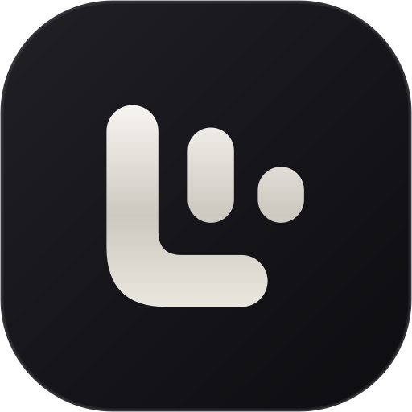
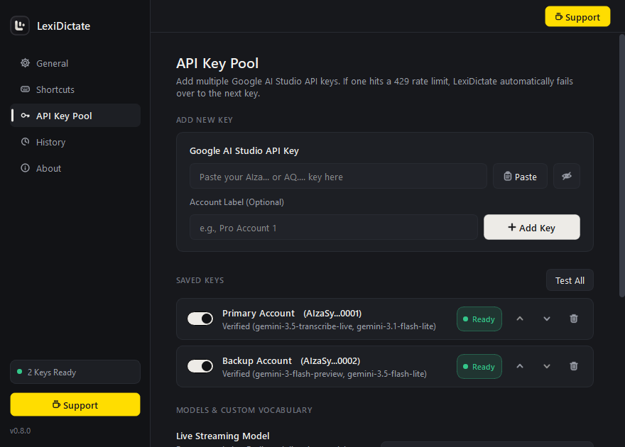
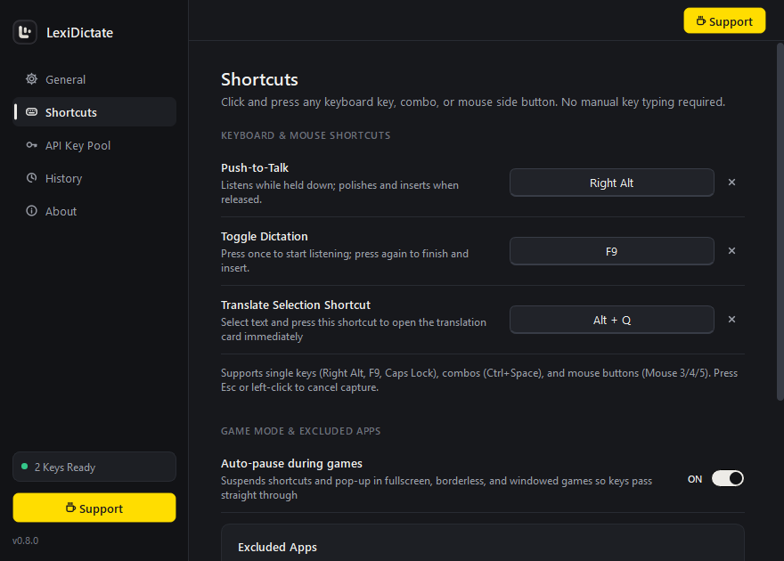

# LexiDictate

System-wide voice dictation for Windows powered by Gemini Live and Flash.

### [Download LexiDictate 0.8.0 for Windows](https://github.com/lexi-apps/lexi-dictate/releases/latest)

Run <code>LexiDictate-Setup-0.8.0.exe</code> from the latest release. Windows 10 or Windows 11 (64-bit).

[Overview](#overview) · [Features](#features) · [Screenshots](#screenshots) · [Installation](#installation) · [FAQ](#faq)

 

---

## Overview

LexiDictate lets you dictate into any Windows text field without switching windows. It watches text cursor focus across browsers and native desktop apps, captures `40 ms` WASAPI audio chunks with an adaptive VAD trailing window, streams partial speech live via a cached Gemini Live connection, flushes trailing silence instantaneously on release so final words are never clipped, applies optional Flash polishing/translation or commits live text directly in under a second, executes spoken editing commands, and pastes cleanly without clobbering your clipboard. You can also highlight any short English or foreign-language snippet in apps like Discord or Chrome and translate it right where you read it using the small selection icon or `Alt + Q`.

Audio and keys move directly between your machine and Google AI Studio using your own API keys.

## Features

| Capability | Details |
|---|---|
| **Resizable compact floating capsule** | Sleek `85%` default (`40×40` idle circle / `32px` adaptive capsule) with a live-preview **Pop-up Size** slider (`65%–120%` in `5%` steps), compact mini-pill when live preview is off, right-click **Polish Mode** submenu (**Smart**, **Verbatim**, 14-language **Translate**), and a draggable fixed-position option. |
| **Quick selection translation (Icon + `Alt + Q`)** | Highlight a message or snippet in Discord, browsers, or desktop apps to show a tiny non-activating translate icon near your cursor (zero API calls until clicked) or press **`Alt + Q`** directly to open the floating translation card. Includes a one-click **`TR ↔ EN`** flip, **Copy** button, `1500`-char limit, 20-item RAM cache, `Win+V`/image clipboard protection, and automatic skips in terminals and games. |
| **Sub-second live dictation & optional full-audio verify** | Reuses cached Gemini Live client sessions, streams `40 ms` WASAPI audio chunks with an adaptive VAD trailing tail, and sends an instant trailing silence flush on stop to prevent dropped final syllables. Commits live transcripts fast (`~0.4–0.7s`) with automatic full-audio fallback, or enable **Full-audio verification** for complete audio re-analysis (`~1.2s`). |
| **Voice dictation commands (TR & EN)** | Toggleable spoken commands (**`new line`** / **`yeni satır`**, **`new paragraph`** / **`yeni paragraf`**, **`undo dictation`** / **`son dikteyi sil`**, **`press enter`** / **`enter bas`**, **`select all`** / **`hepsini seç`**) protected by natural-prose false-trigger guards. |
| **One-click retry recovery (RAM-only)** | Retains the last failed dictation audio transiently in RAM (`15 MB` cap, `10 min` TTL, never written to disk) with an inline **Retry** button on the error toast plus tray and pop-up right-click retry actions. |
| **Quick custom vocabulary** | Boost technical & brand recognition with one-click **+ Tech Pack (30)** developer terms and **+ Vocab** shortcuts directly on every History card. |
| **Spoken language hints** | Select **Turkish + English**, **Turkish Only**, **English Only**, or **Automatic** under **General -> Dictation & Pop-up** to pass explicit BCP-47 language hints to both Gemini Live streaming and Flash processing. |
| **Faithful polishing & 14-language translation** | Removes fillers and resolves inline self-corrections in **Smart Polish** while preserving casual tone, product names, and version numbers; keeps exact wording in **Verbatim**; and preserves register across 14 **Translation** targets (English, Turkish, German, French, Spanish, Italian, Russian, Japanese, Korean, Simplified Chinese, Arabic, Portuguese, Dutch, Polish). |
| **Curated fast-first model presets** | Lists vetted low-latency Live models (`gemini-3.5-transcribe-live`, `gemini-3.1-flash-live-preview`, `gemini-2.5-flash-native-audio-latest`, `gemini-3.8-live`) and fast-first Flash post-processing models (`gemini-3-flash-preview` default with zero thinking budget, `gemini-3.5-flash-lite`, `gemini-3.1-flash-lite`, `gemini-3.5-flash`, `gemini-3.8-flash`) with duration-aware `10s`/`18s` deadlines. |
| **Multi-key 429 & instant 502/503/504 failover** | Add multiple Google AI Studio API keys in priority order. When one key hits a `429` quota limit, LexiDictate places it in escalating cooldown and switches to the next ready key, with immediate fallback on transient `502`/`503`/`504` or timeout errors. |
| **One-click shortcuts** | Bind single keys (`Right Alt`, `F9`, `Caps Lock`), combinations (`Ctrl+Space`), or mouse side buttons (`Mouse 3/4/5`) by pressing them directly, with duplicate conflict detection and AltGr handling for Turkish layouts. |
| **Game Mode auto-pause & screenshot whitelist** | Automatically suspends shortcuts, the floating pop-up, and update notices in exclusive fullscreen, borderless fullscreen, and windowed games (via engine window classes, Steam/Epic/Riot/Xbox/GOG/EA/Ubisoft paths, and Windows GameConfigStore), while whitelisting screenshot and overlay tools (`Lightshot`, `ShareX`, `Snipping Tool`, `Greenshot`, `Flameshot`, `OBS`) so they never cause false pauses. Includes a custom **Excluded Apps** picker and tray **Pause / Resume** toggle. |
| **Clipboard-safe insertion** | Restores your previous clipboard contents after pasting, or inserts directly via Win32 Unicode `SendInput` without touching the clipboard. |
| **Built-in updates and issue reports** | Checks GitHub Releases for new installers, verifies SHA-256 checksums, and includes a privacy-filtered bug report dialog that strips API keys and user paths before sending. |
| **Local-first storage & bilingual UI** | Zero telemetry, ads, or intermediary accounts. Configuration and API keys stay in `%APPDATA%\LexiDictate\config.json`, with instant real-time English and Turkish UI switching. |

## Screenshots

### API Key Pool and Model Presets

| Shortcuts and Game Mode | Floating Pop-up States & Sizes |
|---|---|
|  |  |

### Updates and Issue Reporting

## Installation

1. Download **`LexiDictate-Setup-0.8.0.exe`** from the [latest release](https://github.com/lexi-apps/lexi-dictate/releases/latest).
2. Run the installer. Because the binary is not code-signed yet, Windows SmartScreen may ask for confirmation: choose **More info -> Run anyway**.
3. Create an API key in [Google AI Studio](https://aistudio.google.com/apikey) and add it under **API Key Pool**.
4. Configure your **Push-to-Talk** or **Toggle** binding under **Shortcuts**, focus any text field, and start speaking.

**Requirements:** Windows 10 or Windows 11 (64-bit).

## FAQ

<b>Is LexiDictate free?</b>

Yes. LexiDictate is freeware with no subscriptions, ads, or usage tiers.

<b>Why do I bring my own Google AI Studio API key?</b>

Using your own API key keeps latency low and avoids any third-party relay or account sign-up. You can also load several keys so dictation continues seamlessly if one account reaches its quota limit.

<b>How do voice dictation commands and Retry recovery work?</b>

When **Voice dictation commands** is enabled under **General**, spoken formatting and editing commands (`new line` / `yeni satır`, `new paragraph` / `yeni paragraf`, `undo dictation` / `son dikteyi sil`, `press enter` / `enter bas`, `select all` / `hepsini seç`) are executed automatically with natural-prose false-trigger guards so ordinary sentences remain untouched. If a temporary network or API timeout interrupts processing, LexiDictate holds only the last failed audio briefly in RAM (`15 MB` cap, `10 min` TTL, never saved to disk) so you can click **Retry** on the toast notification, tray menu, or pop-up context menu without re-speaking.

<b>How does Quick Selection Translation work without messing up my clipboard or quota?</b>

Selecting text shows a small floating icon (it does nothing and sends zero API requests unless you click it) or you can trigger translation right away with `Alt + Q` (customizable under **Shortcuts**). LexiDictate reads the selection via Windows UI Automation first without touching the clipboard at all, and only falls back to a quiet one-off copy in apps like Discord when needed — hiding it from `Win+V` clipboard history, restoring your previous copied text afterwards, skipping if you have a screenshot/file on your clipboard, and staying inactive in terminal windows and games. Requests are capped at `1500` characters and the last 20 translations stay cached in RAM.

<b>How does Game Mode auto-pause work for fullscreen and windowed games?</b>

When **Auto-pause during games** is enabled under **Shortcuts**, LexiDictate automatically detects exclusive Direct3D fullscreen games, borderless fullscreen games, and windowed games (via engine window classes, Windows `GameConfigStore`, and Steam/Epic/Riot/Xbox/GOG/EA/Ubisoft library paths) and suspends hotkeys and the floating pop-up until you switch back, while keeping screenshot/overlay utilities (`Lightshot`, `ShareX`, `Snipping Tool`, `Greenshot`, `Flameshot`, `OBS`) whitelisted. You can also add custom `.exe` executables under **Excluded Apps** (or pick from currently running windows) and manually toggle **Pause / Resume Dictation** anytime from the system tray menu. While paused, all keyboard keys and mouse side buttons pass straight through to the game without being intercepted.

<b>How do updates and bug reports work?</b>

Under **About -> Updates**, LexiDictate checks this repository for new releases, verifies the downloaded installer against `SHA256SUMS.txt`, and launches the silent updater when you click **Restart & Install Update**. Under **Report an Issue**, it builds a local diagnostic summary with API keys and Windows user paths redacted, and lets you inspect the exact text before submitting.

<b>Does LexiDictate upload my dictation history or files?</b>

No. Audio is streamed only while a dictation session is active; failed-session retry snapshots exist strictly in RAM for up to 10 minutes and are never written to disk. Settings, custom vocabulary, keys, and recent history stay strictly local in `%APPDATA%\LexiDictate\config.json`.

## Support

If LexiDictate saves you time, you can support ongoing development on Patreon or Buy Me a Coffee:

## More from Lexi Apps

- **Website:** [lexi-apps.pages.dev](https://lexi-apps.pages.dev/lexi-dictate/)
- **Discord:** [discord.gg/HN9eWThUn2](https://discord.gg/HN9eWThUn2)
- **[Lexi Download Manager](https://github.com/lexi-apps/lexi-download-manager):** Multi-part Windows download manager with video site downloads, torrents, and browser integration.
- **[Lexi Ren'Py Translator](https://github.com/lexi-apps/lexi-renpy-translator):** Translation tool for Ren'Py visual novels with glossary support.

## License

LexiDictate is free to use (freeware). The application source code is proprietary and is not published in this distribution repository.

## Contact

Bug reports and questions: **lexiapps@protonmail.com**

---

© Lexi Apps

