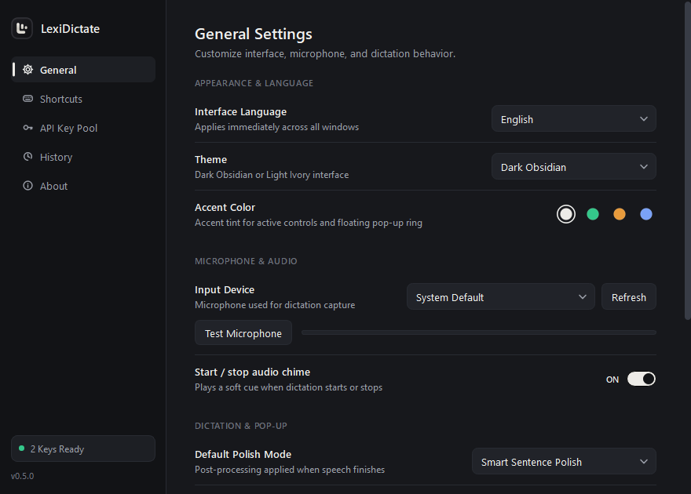

# LexiDictate

System-wide voice dictation for Windows powered by Gemini Live and Flash.

### [Download LexiDictate 0.5.0 for Windows](https://github.com/lexi-apps/lexi-dictate/releases/latest)

Run <code>LexiDictate-Setup-0.5.0.exe</code> from the latest release. Windows 10 or Windows 11 (64-bit).

[Overview](#overview) · [Features](#features) · [Screenshots](#screenshots) · [Installation](#installation) · [FAQ](#faq)

 

---

## Overview

LexiDictate lets you dictate into any Windows text field without switching windows. It watches text cursor focus across browsers and native desktop apps, streams partial speech live while you talk, cleans up filler words and self-corrections with Gemini Flash, and pastes the finished sentence back without clobbering your clipboard.

Audio and keys move directly between your machine and Google AI Studio using your own API keys.

## Features

| Capability | Details |
|---|---|
| **Focus-aware floating capsule** | Appears near active text inputs across browsers, editors, and messaging apps, hides when clicking non-editable areas, and never steals window focus. Includes a draggable fixed-position option. |
| **Multi-sentence live preview** | Streams interim transcripts as you speak across multiple pauses and sentences via Gemini Live, falling back to full buffered audio if a stream cuts off early. |
| **Sentence polishing and multi-language translation** | Strips filler words, resolves inline self-corrections, fixes punctuation, and keeps English technical terms intact inside Turkish speech. Supports **Smart Polish**, **Verbatim**, and single-pass **Translation** into 14 target languages (English, Turkish, German, French, Spanish, Italian, Russian, Japanese, Korean, Simplified Chinese, Arabic, Portuguese, Dutch, Polish). |
| **Curated model presets** | Lists vetted low-latency Live models (`gemini-3.5-transcribe-live`, `gemini-3.1-flash-live-preview`, `gemini-2.5-flash-native-audio-latest`, `gemini-3.8-live`) and Flash post-processing models (`gemini-3.1-flash-lite`, `gemini-3-flash-preview`, `gemini-3.5-flash-lite`, `gemini-3.5-flash`, `gemini-3.8-flash`) with speed and quality notes. |
| **Multi-key 429 failover** | Add multiple Google AI Studio API keys in priority order. When one key hits a `429` quota limit, LexiDictate places it in escalating cooldown and switches to the next ready key, with transient `503` model fallback built in. |
| **One-click shortcuts** | Bind single keys (including `Right Alt`, `F9`, `Caps Lock`), combinations (`Ctrl+Space`), or mouse side buttons (`Mouse 3/4/5`) by pressing them directly, with duplicate conflict detection and AltGr handling for Turkish layouts. |
| **Game Mode auto-pause** | Automatically suspends shortcuts, the floating pop-up, and update notices in exclusive fullscreen, borderless fullscreen, and windowed games (via engine window classes, Steam/Epic/Riot/Xbox/GOG/EA/Ubisoft paths, and Windows GameConfigStore). Keys pass straight through with zero added latency, alongside a custom **Excluded Apps** picker and tray **Pause / Resume** toggle. |
| **Clipboard-safe insertion** | Restores your previous clipboard contents after pasting, or inserts directly via Win32 Unicode `SendInput` without touching the clipboard. |
| **Built-in updates and issue reports** | Checks GitHub Releases for new installers, verifies SHA-256 checksums, and includes a privacy-filtered bug report dialog that strips API keys and user paths before sending. |
| **Local-first storage** | No telemetry, ads, or intermediary accounts. Configuration and API keys stay in `%APPDATA%\LexiDictate\config.json`. |
| **Bilingual interface** | Full English and Turkish interface switching in real time. |

## Screenshots

### API Key Pool and Model Presets

| Shortcuts and Game Mode | Floating Pop-up States |
|---|---|
|  |  |

### Updates and Issue Reporting

## Installation

1. Download **`LexiDictate-Setup-0.5.0.exe`** from the [latest release](https://github.com/lexi-apps/lexi-dictate/releases/latest).
2. Run the installer. Because the binary is not code-signed yet, Windows SmartScreen may ask for confirmation: choose **More info -> Run anyway**.
3. Create an API key in [Google AI Studio](https://aistudio.google.com/apikey) and add it under **API Key Pool**.
4. Configure your **Push-to-Talk** or **Toggle** binding under **Shortcuts**, focus any text field, and start speaking.

**Requirements:** Windows 10 or Windows 11 (64-bit).

## FAQ

<b>Is LexiDictate free?</b>

Yes. LexiDictate is freeware with no subscriptions, ads, or usage tiers.

<b>Why do I bring my own Google AI Studio API key?</b>

Using your own API key keeps latency low and avoids any third-party relay or account sign-up. You can also load several keys so dictation continues seamlessly if one account reaches its quota limit.

<b>How does Game Mode auto-pause work for fullscreen and windowed games?</b>

When **Auto-pause during games** is enabled under **Shortcuts**, LexiDictate automatically detects exclusive Direct3D fullscreen games, borderless fullscreen games, and windowed games (via engine window classes, Windows `GameConfigStore`, and Steam/Epic/Riot/Xbox/GOG/EA/Ubisoft library paths) and suspends hotkeys and the floating pop-up until you switch back. You can also add custom `.exe` executables under **Excluded Apps** (or pick from currently running windows) and manually toggle **Pause / Resume Dictation** anytime from the system tray menu. While paused, all keyboard keys and mouse side buttons pass straight through to the game without being intercepted.

<b>How do updates and bug reports work?</b>

Under **About -> Updates**, LexiDictate checks this repository for new releases, verifies the downloaded installer against `SHA256SUMS.txt`, and launches the silent updater when you click **Restart & Install Update**. Under **Report an Issue**, it builds a local diagnostic summary with API keys and Windows user paths redacted, and lets you inspect the exact text before submitting.

<b>Does LexiDictate upload my dictation history or files?</b>

No. Audio is streamed only while a dictation session is active. Settings, custom vocabulary, keys, and recent history stay strictly local in `%APPDATA%\LexiDictate\config.json`.

## Support

If LexiDictate saves you time, you can support ongoing development on Patreon or Buy Me a Coffee:

## More from Lexi Apps

- **Website:** [lexi-apps.github.io](https://lexi-apps.github.io/)
- **[Lexi Download Manager](https://github.com/lexi-apps/lexi-download-manager):** Multi-part Windows download manager with video site downloads, torrents, and browser integration.
- **[Lexi Ren'Py Translator](https://github.com/lexi-apps/lexi-renpy-translator):** Translation tool for Ren'Py visual novels with glossary support.

## License

LexiDictate is free to use (freeware). The application source code is proprietary and is not published in this distribution repository.

## Contact

Bug reports and questions: **lexiapps@protonmail.com**

---

© Lexi Apps

