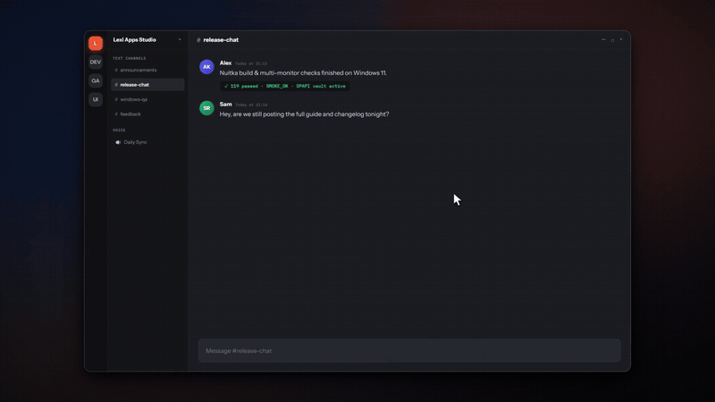
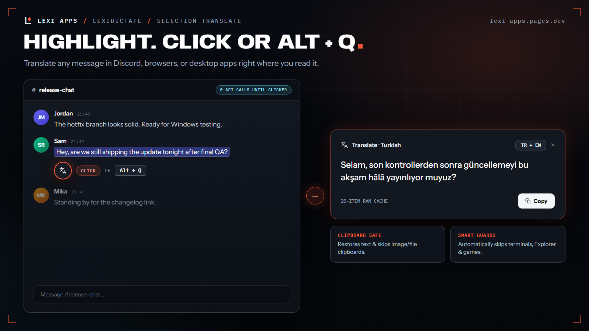
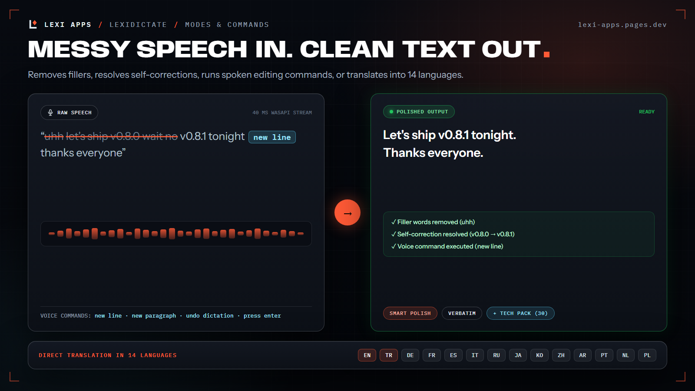
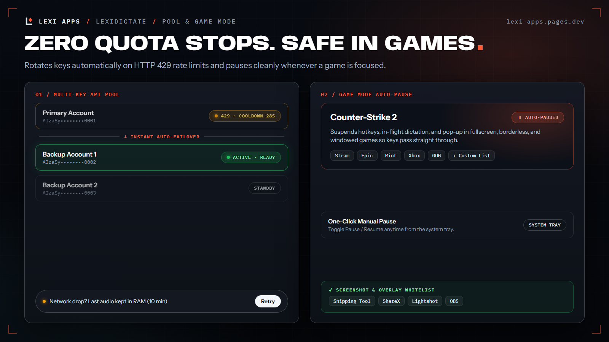
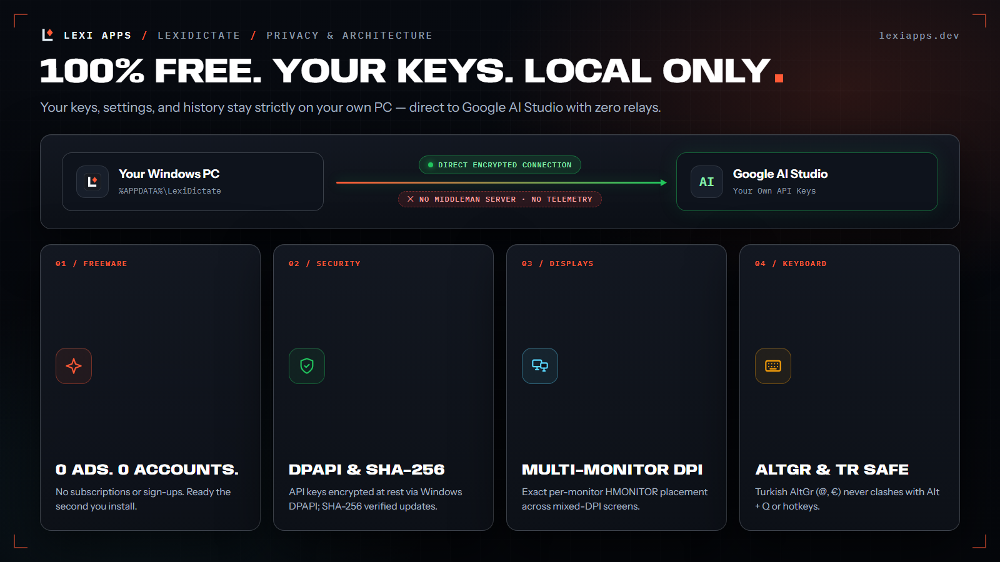
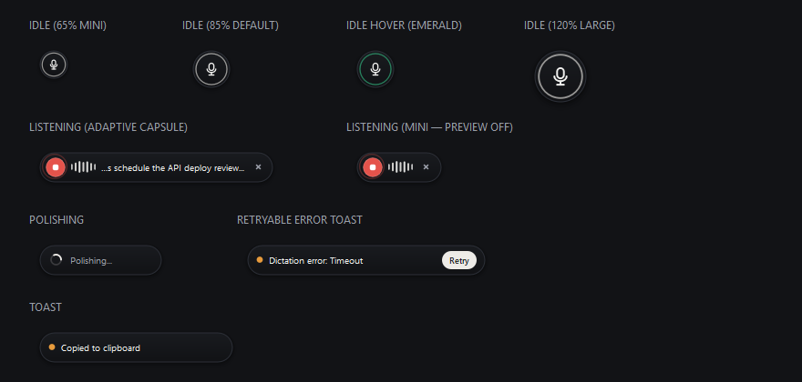
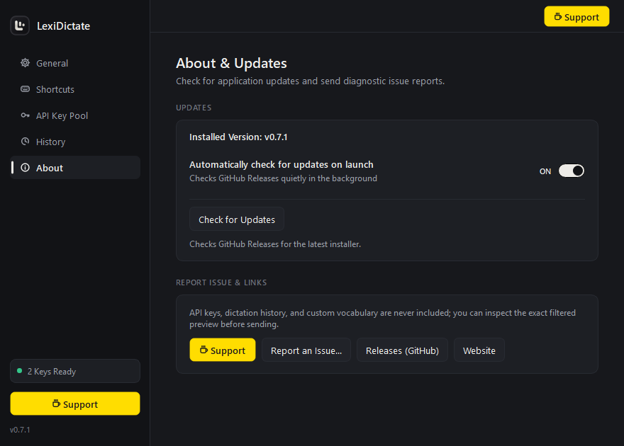

# LexiDictate

**Speak anywhere on Windows. Paste clean text in ~0.5s — or highlight text and translate with `Alt + Q`.**

### [Download LexiDictate 0.8.6 for Windows](https://github.com/lexi-apps/lexi-dictate/releases/latest)

Run <code>LexiDictate-Setup-0.8.6.exe</code> · Windows 10 & 11 (64-bit) · 100% Freeware · Bring your own Gemini API key

 

~14-second interactive highlight — live dictation &amp; Alt + Q selection translate · Click any feature card below for full 1600×900 detail · <a href="https://lexi-apps.pages.dev/lexi-dictate/">Watch full 31s 60fps showcase on website ↗</a>

---

## See It in Action

<table>
  <tr>
    <td width="50%">
      
    </td>
    <td width="50%">
      
    </td>
  </tr>
  <tr>
    <td width="50%">
      
    </td>
    <td width="50%">
      
    </td>
  </tr>
</table>

---

## At a Glance

- **Sub-Second Live Voice:** Hold `Right Alt` (or any key / mouse button), speak naturally, and paste into Discord, Chrome, VS Code, or any Windows text box in `~0.5s` without losing focus.
- **Quick Selection Translate (`Alt + Q`):** Highlight any snippet for a tiny translate icon (0 API calls until clicked) or press `Alt + Q`, with `TR ↔ EN` flip and clipboard protection.
- **Smart Polish, Commands & 14 Languages:** Strips fillers, resolves self-corrections, runs TR/EN voice commands (`new line`, `new paragraph`, `undo dictation`), or translates directly into 14 languages.
- **Multi-Key `429` Failover & Retry:** Rotate multiple Gemini API keys automatically on rate limits, plus one-click RAM-only **Retry** (auto-clears after 10 min).
- **Game Mode & Multi-Monitor Ready:** Auto-pauses in fullscreen/borderless/windowed games (whitelisting Snipping Tool, ShareX, Lightshot, OBS), supports mixed-DPI monitors (`HMONITOR`), and keeps Turkish `AltGr` (`@`, `€`) clash-free.
- **Local-First & Verified:** Zero ads, accounts, or middleman servers — API keys are encrypted at rest with Windows DPAPI (CurrentUser), plus fail-closed SHA-256 silent updates and privacy-redacted bug reports.

---

## Quick Start (30 Seconds)

1. Download and run **`LexiDictate-Setup-0.8.6.exe`** from the [latest release](https://github.com/lexi-apps/lexi-dictate/releases/latest) *(if SmartScreen prompts, choose **More info → Run anyway**)*.
2. Get a free API key from [Google AI Studio](https://aistudio.google.com/apikey) and paste it into **API Key Pool**.
3. Click any text box, hold **`Right Alt`**, speak, and release.

---

<b>App Screens — Floating Capsule & Settings (5 screenshots)</b>

 

| Floating Pop-up & Translation Card | General Settings |
|---|---|
|  |  |

| API Key Pool & Models | Shortcuts & Game Mode |
|---|---|
|  |  |

---

## FAQ

<b>Is LexiDictate free?</b>

Yes — 100% freeware with no ads, subscriptions, or accounts. You connect directly to Google AI Studio using your own API key.

<b>Does selection translation use quota automatically?</b>

No. Highlighting text sends zero API requests until you click the floating icon or press `Alt + Q`, and the last 20 translations are cached in RAM.

<b>Does it interfere with games or my clipboard?</b>

No. Game Mode automatically suspends hotkeys and active dictation in games, and clipboard insertion preserves screenshots/files while restoring previous text automatically.

<b>Where is my data stored?</b>

Strictly locally in `%APPDATA%\LexiDictate\config.json`, with your API key values encrypted via Windows DPAPI (CurrentUser scope). Audio is streamed directly to Google AI Studio only while dictating, and failed-session Retry audio lives solely in RAM for up to 10 minutes.

---

## Support & Links

- **Website:** [lexi-apps.pages.dev/lexi-dictate](https://lexi-apps.pages.dev/lexi-dictate/)
- **Discord:** [discord.gg/HN9eWThUn2](https://discord.gg/HN9eWThUn2)
- **More Apps:** [Lexi Download Manager](https://github.com/lexi-apps/lexi-download-manager) · [Lexi Ren'Py Translator](https://github.com/lexi-apps/lexi-renpy-translator)
- **Contact:** `lexiapps@protonmail.com` · Freeware (proprietary source)

---

© Lexi Apps

